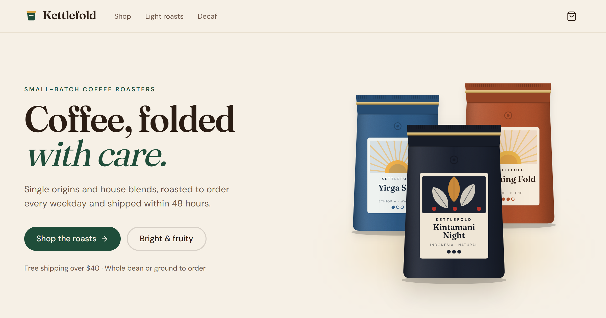
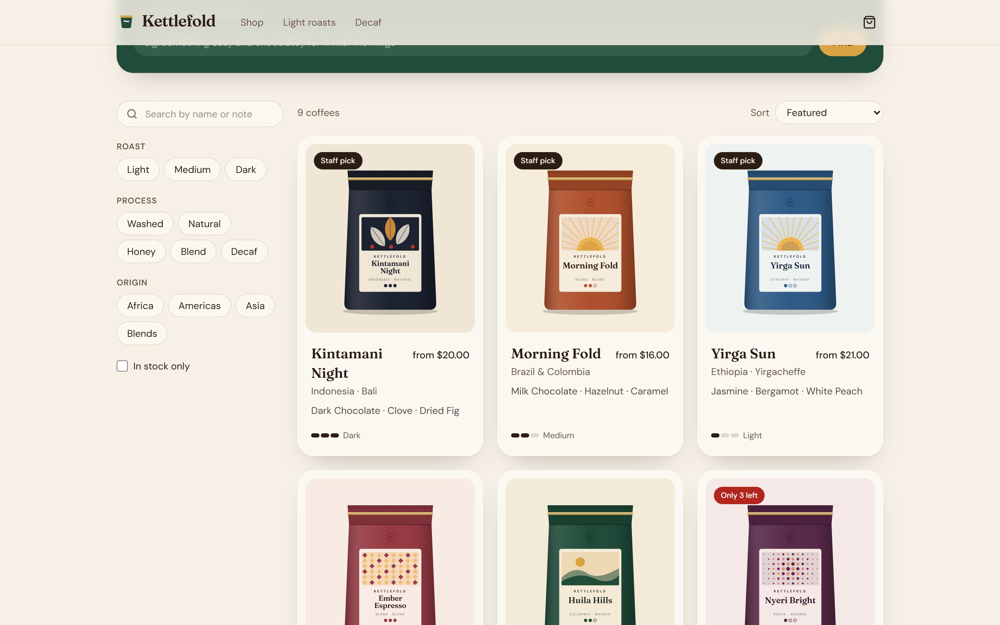
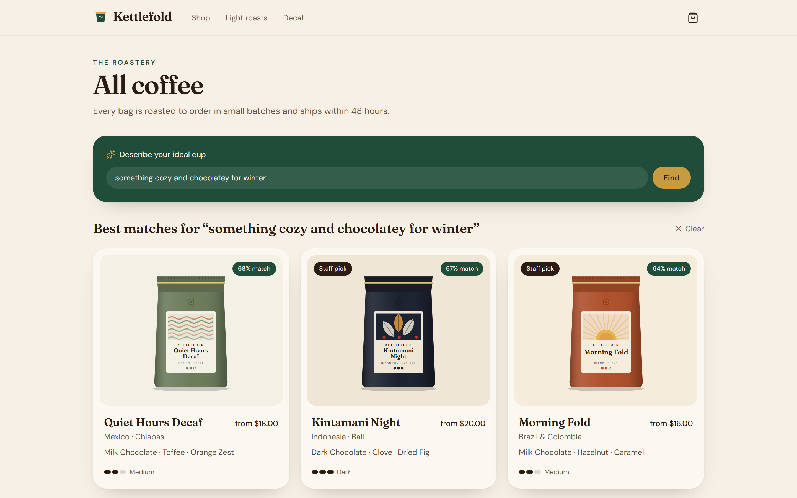
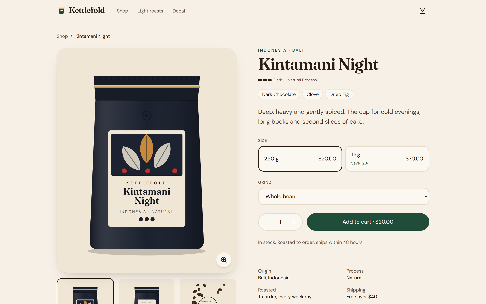
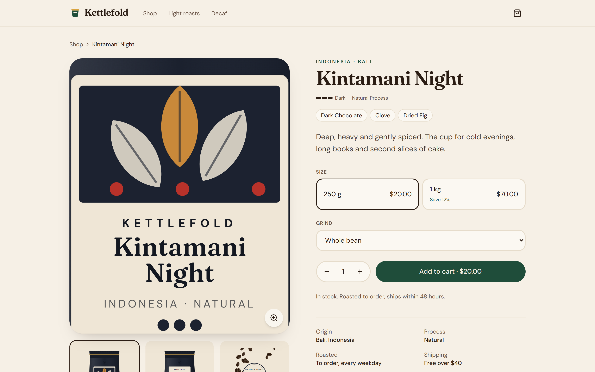
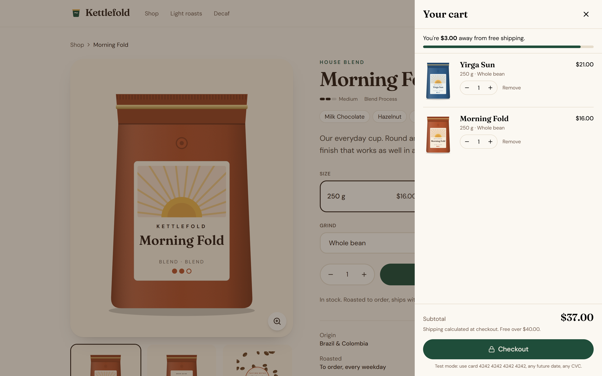
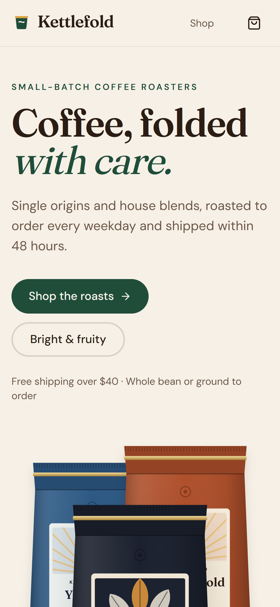
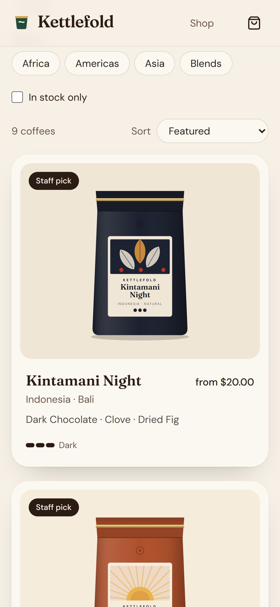
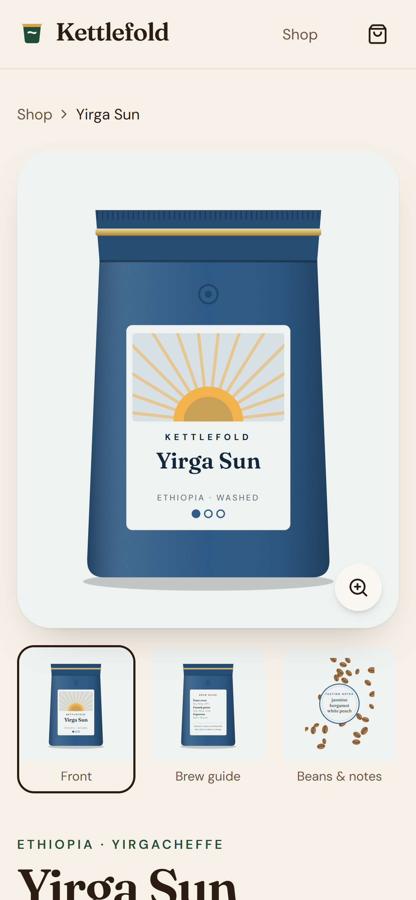

# Kettlefold Coffee: an e-commerce storefront

**Live site:** https://kettlefold-coffee.vercel.app

A small-batch coffee roaster's online shop. You can filter the shop, zoom into a bag, describe the cup you want in your own words, and check out through Stripe. Every order is saved once, stock goes down, and a receipt arrives by email.

> Kettlefold is a fictional brand made for a portfolio. Checkout runs in **Stripe test mode**: use card `4242 4242 4242 4242`, any future date and any CVC. No real money moves.



## Screenshots

| Shop with filters | Taste search |
|---|---|
|  |  |

| Product page | Zoom | Cart |
|---|---|---|
|  |  |  |

| Mobile home | Mobile shop | Mobile product |
|---|---|---|
|  |  |  |

More in [`docs/screenshots`](docs/screenshots). The case study is in [`docs/case-study.md`](docs/case-study.md).

## Features
- **Shop with filters:** roast, region, process and "in stock only", plus keyword search and sorting by price. Filters are kept in the URL, so a filtered view can be shared or bookmarked.
- **Taste search (AI):** type something like *"bright and fruity for iced coffee"*. The query is turned into an embedding with Gemini and matched against the coffees in Postgres with **pgvector**. Each product page also shows "If you like this, try…" from the same vectors.
- **Product pages with zoom:** hover to magnify where you point, or use the zoom button on touch and keyboard. The bags are drawn as SVG, so they stay sharp at any zoom. Each bag has three views: front, brew guide and beans.
- **Cart:** a slide-out drawer saved in the browser and kept in sync across tabs. It shows how far you are from free shipping ($40) and blocks quantities beyond what's in stock.
- **Stripe Checkout (test mode):** hosted payment page, shipping address and shipping rates.
- **Order handling:** a signed Stripe webhook records the order and lowers stock, then a Resend email receipt goes out. The success page shows the receipt.
- **Admin:** a page limited to listed emails. Admins can edit prices, stock and visibility inline, and add a new coffee with a live preview of its bag. New coffees are added to taste search automatically.

## How an order works

```
 cart (browser) ──▶ /api/checkout ──▶ Stripe Checkout ──▶ payment
   only ids +          prices & stock                         │
   quantities          read from Postgres                     ▼
                                              ┌── webhook (signed) ──┐
                                              │                      ├─▶ fulfillSession()
                                              └── success page ──────┘        │
                                                                              ▼
                                       shop_record_order(): insert order ON CONFLICT DO NOTHING
                                       → lower stock → send receipt (once) → refresh shop cache
```

- **The browser never sets a price.** The checkout route reads prices and stock from the database and builds the Stripe line items itself. A tampered cart can't change what you pay.
- **The order is saved exactly once.** Both the webhook and the success page call the same `fulfillSession()`, and the database function inserts on the unique Stripe session id. Whichever comes first wins, and the other does nothing. That holds even if the webhook is slow or the page is reloaded.
- **Stock is checked twice:** once when checkout starts (including the 1 kg bag, which counts as four 250 g bags) and again when the order is recorded.

## Security and correctness (tested)
- **Checkout abuse:** garbage carts, made-up products, sold-out items, more than is in stock and negative quantities are all rejected. A cart with an edited price was charged the real price.
- **Webhooks:** requests without a valid Stripe signature are rejected.
- **Database:** row-level security on every table. The public key can read active products only, and not their embeddings. It can't read orders, and it can't call the order or vector-search functions. Only the server can.
- **Test mode only:** the app refuses to start checkout with a live Stripe key.
- **A real purchase, end to end:** one order saved, the correct items, stock lowered by exactly one bag each, and the receipt sent. Reloading the success page 3 times in a row and 3 times at once still left **one** order.

## Testing
- **Browser test (headless Chrome), 16 of 16 passing:**
  - filters, kept in the URL
  - "in stock only", keyword search and sorting
  - taste search
  - sold-out and stock limits
  - zoom and gallery views
  - similar coffees
  - the admin redirect
  - no sideways scrolling on phones

## Lighthouse (production build)
| | Performance | Accessibility | Best Practices | SEO |
|---|---|---|---|---|
| Desktop: home | 100 | 100 | 100 | 100 |
| Desktop: product | 100 | 100 | 100 | 100 |
| Mobile: home | 91 | 100 | 100 | 100 |
| Mobile: product | 90 | 100 | 100 | 100 |

## Stack ($0)
Next.js 16 (App Router, Cache Components) · TypeScript · Tailwind CSS v4 · Supabase (Postgres + pgvector, Auth) · Stripe (test mode) · Resend · Gemini embeddings (free tier) via the Vercel AI SDK · Vercel Hobby

## Run locally
```bash
npm install
cp .env.example .env.local   # Supabase, Stripe test key, Resend, Gemini, ADMIN_EMAILS
npm run dev
```

1. **Set up the database:** run [`supabase/schema.sql`](supabase/schema.sql) in the Supabase SQL editor. It enables pgvector, creates the tables, policies and functions, and seeds nine coffees.
2. **Turn on taste search:** run `npm run embed` to compute embeddings for the seeded coffees.
3. **Receive webhooks locally (optional):** run `stripe listen --forward-to localhost:3000/api/stripe/webhook` and put the printed secret in `STRIPE_WEBHOOK_SECRET`. Without it, the success page still records the order.
4. **Sign in as admin:** add your email to `ADMIN_EMAILS`, and add `http://localhost:3000/**` to the Supabase Auth redirect URLs for the magic link.

## Project structure
```
src/
  app/
    page.tsx                 # home
    shop/                    # shop grid + /shop/[slug] product pages (pre-rendered)
    order/success/           # receipt page (also fulfills the order if the webhook hasn't yet)
    admin/                   # product table + new product form (server actions, admin-only)
    api/checkout/            # validates the cart against the database, creates the Stripe session
    api/stripe/webhook/      # signed webhook → fulfillSession()
    api/search/              # taste search: embed the query → pgvector match
  components/                # coffee bag art, gallery/zoom, buy box, cart drawer, shop browser
  lib/
    fulfill.ts               # one idempotent path from a paid session to a saved order
    catalog.ts cart.ts       # sizes, pricing, cart store
    embeddings.ts similar.ts # Gemini embeddings, nearest neighbors
    stripe.ts email.ts       # test-mode-only Stripe client, Resend receipt
  proxy.ts                   # keeps the admin session fresh
scripts/embed-products.mjs   # npm run embed
supabase/schema.sql
docs/                        # thumbnail, screenshots, case study
```

## What I learned
- **Never trust the cart.** The browser sends only what you want and how many. Prices, stock and totals come from the server every time.
- **Payment confirmations arrive more than once.** Webhooks retry and people reload pages. A unique key on the Stripe session plus `ON CONFLICT DO NOTHING` made saving the order safe to repeat.
- **Caching needs a plan for change.** The shop is cached for speed, so orders and admin edits refresh it on purpose. I also learned where that refresh is allowed to run.
- **Semantic search is a small step from Postgres.** Gemini's free embeddings and pgvector gave useful "describe your cup" results without a separate search service.
- **Column grants matter.** Revoking one column wasn't enough while the whole table was granted, so I granted the safe columns explicitly to keep embeddings private.

_Edit these in your own words before sharing._
