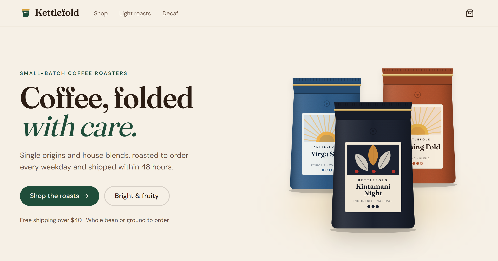
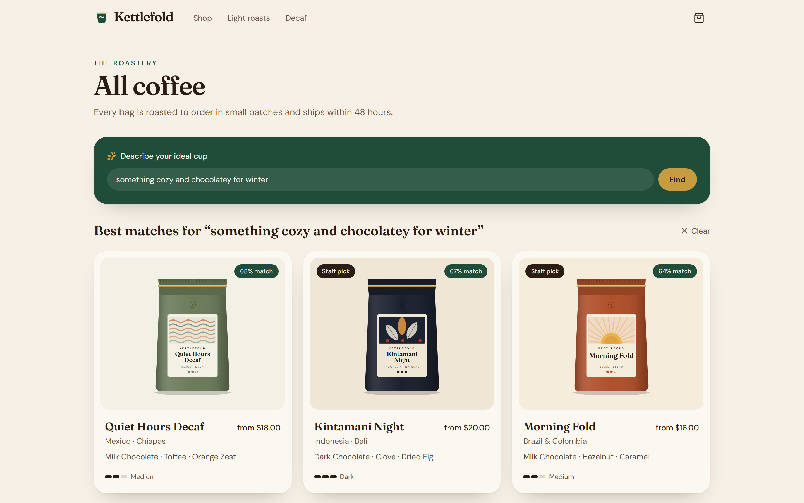
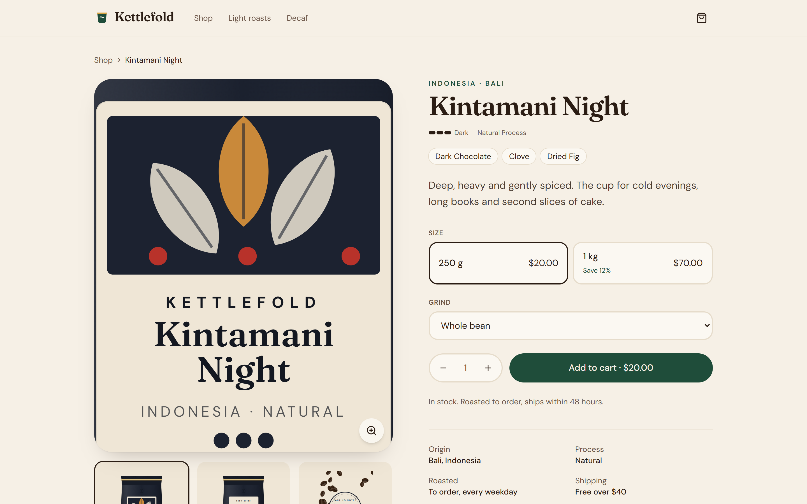
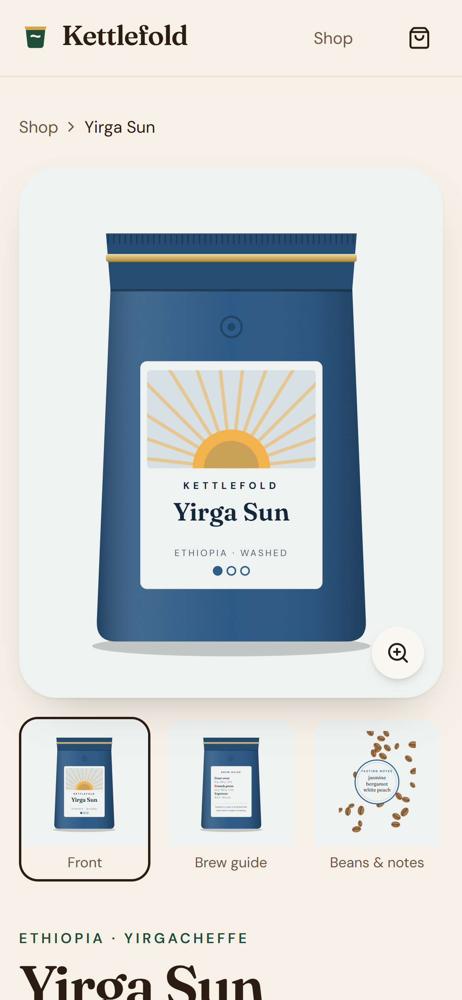

# Kettlefold Coffee: case study

**Role:** Design and development (solo)
**Type:** E-commerce storefront (freelance-style client build)
**Stack:** Next.js 16, TypeScript, Tailwind CSS v4, Supabase (Postgres + pgvector), Stripe (test mode), Resend, Gemini embeddings, Vercel
**Links:** [Live site](https://kettlefold-coffee.vercel.app) · [Code](https://github.com/shervs336/kettlefold-coffee)

---

## Short version (for a portfolio card)

> A premium coffee shop: filters, zoomable product art, a cart that knows the stock, and Stripe checkout with signed webhooks and email receipts. You can also describe the cup you want, and AI search matches it using pgvector. Orders are saved exactly once, even with retries and reloads.

---

## Problem

Small roasters need a shop that feels as considered as their coffee. It also has to be correct with money and stock: a wrong price, a double order or an oversold bag costs real trust.

Most shoppers also don't know the difference between a washed Ethiopian and a natural Sumatra. They do know they want "something chocolatey for winter".

## Approach

- **A brand first.** A warm editorial look (serif headings, paper tones, one green accent), and coffee bags drawn as SVG. That means no stock photos, and every bag stays crisp at any zoom.
- **The server owns the money.** The cart sends only product ids, sizes and quantities. The checkout route reads prices and stock from Postgres and builds the Stripe session from them.
- **One fulfillment path.** The webhook and the success page both call one function. A database function records the order by its unique Stripe session id and lowers stock in the same transaction.
- **Taste search.** Each coffee's notes, roast, origin and description are embedded with Gemini's free model and stored in pgvector. A shopper's sentence is embedded the same way and matched by cosine distance.

## Key decisions

| Decision | Why |
|---|---|
| Stripe Checkout (hosted) instead of a custom card form | PCI scope stays with Stripe, and it handles wallets, addresses and 3-D Secure for free. |
| Prices built server-side with `price_data` | No Stripe products to keep in sync, and a tampered cart can't change a price. |
| `insert … on conflict (stripe_session_id) do nothing` | Webhook retries, a slow webhook and page reloads all end in one order. |
| Fulfill from both the webhook and the success page | The receipt shows right away, even if the webhook arrives late or isn't set up locally. |
| Sizes as "bags of stock" (1 kg = 4 bags) | One stock number per coffee, checked the same way at checkout and when recording the order. |
| Cached catalog, refreshed with tags | Product pages are pre-rendered and fast. Orders and admin edits refresh the cache on purpose. |
| Explicit column grants, service-role-only functions | The public key can't read embeddings or orders, or call the functions that write them. |
| Test-mode-only Stripe client | A live key is refused, so the demo can never take real money. |

## Testing

- **Checkout abuse:** garbage carts, made-up products, sold-out items, carts over the stock limit and negative quantities are all rejected. A cart with an edited price was charged the real price ($16.00).
- **Webhook:** unsigned requests are rejected.
- **Database permissions:** checked with the public key. It can't read embeddings or orders, and it can't call the order function.
- **Real test purchase through Stripe:** one order, correct items, stock down by exactly one bag each, and the receipt sent. Reloading the success page 3 times in a row and 3 times at once still left one order and the same stock.
- **Browser test (headless Chrome), 16/16 passing:** filters kept in the URL, search, sorting, taste search, stock limits, zoom, gallery, similar coffees, admin redirect, and no sideways scrolling on phones.

## Result

- Live and free to run (Supabase free tier, Stripe test mode, Resend and Gemini free tiers, Vercel Hobby).
- **Lighthouse:** Desktop 100 / 100 / 100 / 100 on home and product pages. Mobile 91 / 100 / 100 / 100 on home and 90 / 100 / 100 / 100 on a product page.

| Product zoom | Mobile |
|---|---|
|  |  |

## What I'd do next

- Customer accounts with order history.
- Subscriptions ("a bag every two weeks") with Stripe Billing in test mode.
- Discount codes, and an admin view of orders with shipping status.
